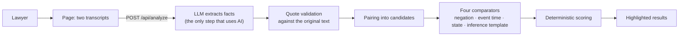

# Deposition Contradiction Detector

A lawyer pastes two deposition transcripts of the same witness, clicks **Find contradictions**, and sees where the story changed. The conflicting passages are highlighted in red in both transcripts, and every finding explains which rule fired and why.

## Run it

```bash
npm run demo
```

This installs dependencies and starts the app at <http://localhost:3000> (Node.js 20 or later).

Then click **Load sample**, followed by **Find contradictions**. The bundled sample (one witness, a March and a September deposition) is analysed from a saved extraction, so it works **without an API key**; a banner says so.

Analysing any other transcripts calls the Anthropic API to extract facts. Set `ANTHROPIC_API_KEY` in your environment or in `.env.local`:

```bash
echo 'ANTHROPIC_API_KEY=sk-ant-...' > .env.local
```

## How it works



1. **Extraction (AI).** The model turns each answer into structured facts: who, which action or state (from a fixed vocabulary), object, place, time, polarity, uncertainty markers, and the exact quote with its character offsets. It never decides whether two facts conflict, and it never produces a score.
2. **Quote validation.** Every quote must appear verbatim at its stated offsets. If it does not, that pair is reported as an analysis error instead of being guessed at.
3. **Pairing.** Facts from the two transcripts are paired by content (same person, same predicate, same kind of event, and so on), not by matching question wording. The extraction call may also nominate pairs worth checking; a nomination only decides *whether* a pair is compared, never the outcome.
4. **Comparators.** Each candidate goes to exactly one comparator. A comparator returns `conflict` only when every condition it needs is established; otherwise it returns `compatible` or `unknown`, listing what is missing.
5. **Scoring and display.** A pure function turns the comparator result into a category and score. Highlights are drawn from the offsets, and every explanation comes from a fixed table of rule and condition codes.

## Categories and scores

| Category | When | Score |
| --- | --- | --- |
| Direct contradiction | Negation, event-time or state rule finds a conflict | 85 |
| Inferential contradiction | A fixed inference template finds a conflict | 75 |
| False positive | The rule finds the statements compatible | none (collapsed by default) |
| Needs review | A rule could not decide; the missing conditions are listed | none |

If the claim the conflict rests on carries an uncertainty marker ("I think I went out"), the score drops by 10, once per finding. Fuzzy words about *time* ("around", "maybe") are not deducted again, because they already widen the time range. Possible scores are therefore 85, 75 and 65. They are versioned policy parameters, not probabilities, so the UI shows no `%`. Unscored findings show a status label, never 0.

When a conclusion relies on a default policy (for example, "evening" meaning 18:00 to 21:00, or a time tolerance of plus or minus 30 minutes for "maybe"), the card carries a visible **Depends on default policy** tag and lists the specific assumptions.

**Why the score never comes from the LLM:** the same two facts must always get the same score, every score must be traceable to a named rule, and a lawyer must be able to check the reasoning. The model's job ends at extraction. The engine reads no model-provided confidence, and an extraction response containing a score, confidence or verdict field is rejected.

## Tests

```bash
npm test          # unit tests (engine comparators, scoring, UI view-model helpers)
npm run typecheck
```

The full design (in Chinese) is in [docs/plan.md](docs/plan.md).

## Limitations

- **Narrow rule coverage, by design.** Only registered rules can produce a contradiction: one inference template (alone vs. co-present), two negation containment/relation rules, and a short table of mutually exclusive states. Anything else ends up in *Needs review* or is not paired at all. "No candidates found" does not mean nothing was missed.
- **Uncalibrated time policy.** The tolerances and vocabulary ranges ("evening", plus or minus 5, 20 or 30 minutes) are initial values that have not been calibrated against real data. Findings that depend on them are tagged.
- **Extraction errors are possible.** The model can miss a statement, misclassify one, or anchor a time wrongly. Quotes are checked against the original text, but the meaning assigned to them is not.
